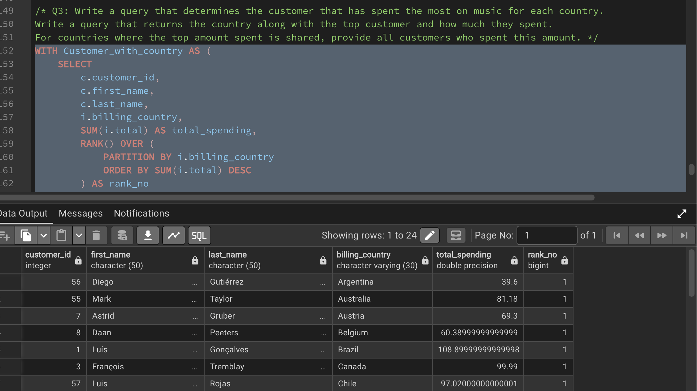
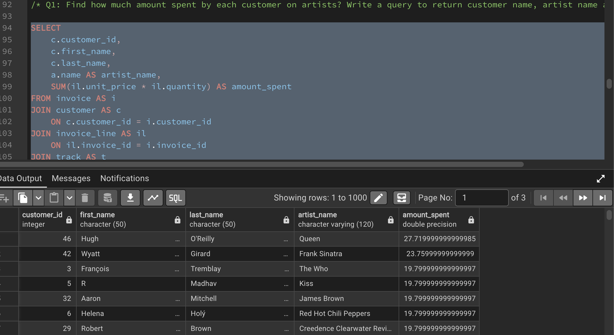
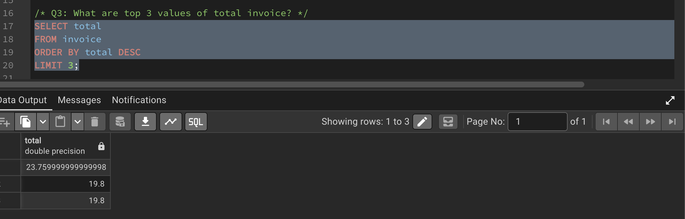

# Music Store SQL Analysis | PostgreSQL

## Project Overview

This project analyses a music store database using PostgreSQL to answer business questions about customers, invoices, artists, music genres, and sales.

The project demonstrates how SQL can be used to explore relational data, identify patterns, compare customer spending, and generate insights that support business understanding.

## Business Objectives

The analysis addresses the following questions:

- Which employee is the most senior?
- Which countries have the highest number of invoices?
- What are the three highest invoice totals?
- Which city has the highest total invoice value?
- Who is the highest-spending customer?
- Which customers listen to Rock music?
- Which artists have the most Rock tracks?
- Which tracks are longer than the average track duration?
- How much does each customer spend on individual artists?
- Which music genre ranks highest by purchase quantity in each country?
- Who is the highest-spending customer in each country?

## Tools and Technologies

- **Database:** PostgreSQL
- **Database management:** pgAdmin
- **Query language:** SQL
- **Version control:** Git and GitHub

## SQL Skills Demonstrated

### Basic SQL
- `SELECT` and `WHERE`
- `ORDER BY` and `LIMIT`
- `DISTINCT`
- Aggregate functions: `COUNT()`, `SUM()`, and `AVG()`
- `GROUP BY`

### Joins and Subqueries
- Combining related tables using joins
- Filtering data using subqueries
- Analysing customer, invoice, artist, track, and genre data

### Advanced SQL
- Common Table Expressions (CTEs)
- Window functions
- `RANK()` and `PARTITION BY`
- Aggregations and rankings within groups

## Project Structure

```text
Music-Store-SQL-Analysis/
├── screenshots/
│   ├── customer_artist_spending.png
│   ├── genre_by_country.png
│   ├── highest_revenue_city.png
│   ├── invoice_counts_by_country.png
│   ├── rock_listeners.png
│   ├── top_3_invoice_totals.png
│   ├── top_customer_by_country.png
│   ├── top_rock_artists.png
│   └── top_spending_customer.png
├── 01_basic_analysis.sql
├── 02_joins_and_subqueries.sql
├── 03_advanced_analysis.sql
├── Music_Store_database.sql
└── README.md
```

## SQL Analysis Files

| File | Description |
|---|---|
| `01_basic_analysis.sql` | Basic business analysis, including invoice counts, invoice totals, city-level revenue, and customer spending. |
| `02_joins_and_subqueries.sql` | Analysis using joins and subqueries to explore Rock music listeners, artists, and track durations. |
| `03_advanced_analysis.sql` | Advanced customer spending analysis, genre rankings by country, and customer comparisons across billing countries. |
| `Music_Store_database.sql` | Database file provided for setting up the analysis environment. |

## Key Findings

The following findings are based on the query results reviewed during this project. Monetary amounts are expressed in the dataset's currency units.

### 1. Invoice Distribution by Country

The United States recorded 131 invoices, followed by Canada with 76 and Brazil with 61.


**Business insight:** Invoice counts help compare transaction activity across markets. Revenue and average invoice value provide additional context when comparing market performance.

### 2. City with the Highest Total Invoice Value

Prague recorded the highest total invoice value in the results reviewed, at approximately 273.24.


**Business insight:** Comparing invoice values across cities helps identify locations with high transaction value.

### 3. Highest-Spending Customer

Customer ID 5, displayed as R Madhav in the query results, recorded total invoice spending of approximately 144.54.


**Business insight:** Identifying high-spending customers can help businesses explore customer engagement and retention opportunities.

### 4. Artists with the Most Rock Tracks

Led Zeppelin ranked first with 114 Rock tracks, followed by U2 with 112 and Deep Purple with 92.

This analysis counts an artist's Rock tracks; it does not measure sales or listener popularity.


**Business insight:** Analysing the music catalogue by artist and genre helps describe the store's available content.

### 5. Most Purchased Genre by Country

The analysis ranks genres within each country by purchase quantity. In the results reviewed, Rock ranked first in several countries, while Alternative & Punk ranked first in Argentina with 17 purchases.

The complete query output should be consulted before drawing conclusions about every country, including tied rankings.


**Business insight:** Comparing genre purchases across countries helps identify differences in music preferences between markets.

### 6. Highest-Spending Customer by Country

The advanced analysis ranks customers by total spending within their billing countries.



**Business insight:** Country-level customer rankings help identify high-value customers in individual markets.

## Additional Query Results

### Customer Spending by Artist

This analysis explores spending associated with individual customers and artists.



### Rock Music Listeners

This analysis identifies customers associated with Rock music purchases.


### Three Highest Invoice Totals

This query identifies the three highest invoice totals in the dataset.



## How to Run the Project

1. Install PostgreSQL and open pgAdmin.
2. Inspect `Music_Store_database.sql` to determine its file format.
3. Create or restore the database using the appropriate procedure for that format.
4. Confirm that the required tables and columns are available in PostgreSQL.
5. Open the SQL files directly from the repository root:
   - `01_basic_analysis.sql`
   - `02_joins_and_subqueries.sql`
   - `03_advanced_analysis.sql`
6. Execute the queries against the configured database.
7. Compare the results with the findings and screenshots in this README.

**Note:** The database setup procedure depends on the format of `Music_Store_database.sql`. Confirm that the database loads successfully before executing the analysis scripts.

## Learning Outcomes

Through this project, I practised:

- Writing SQL queries to answer business questions.
- Filtering, sorting, and aggregating relational data.
- Combining tables using joins.
- Using subqueries to solve analytical problems.
- Applying CTEs and window functions to rank results.
- Analysing customer spending and invoice activity.
- Translating query results into business-oriented observations.

## Conclusion

This project demonstrates the use of PostgreSQL to analyse a music store database and answer practical business questions about customers, transactions, artists, and music genres.

By applying basic SQL, joins, subqueries, CTEs, and window functions, I developed practical experience in querying relational data and interpreting results for business analysis.

This project forms part of my ongoing development of SQL and data analytics skills.
