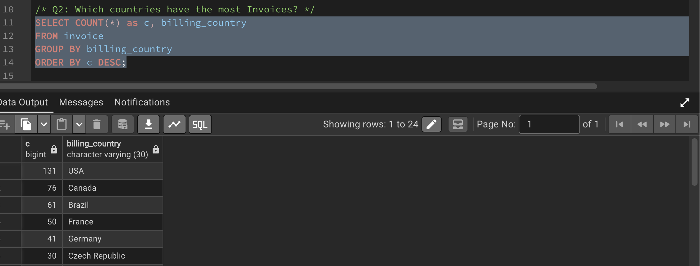
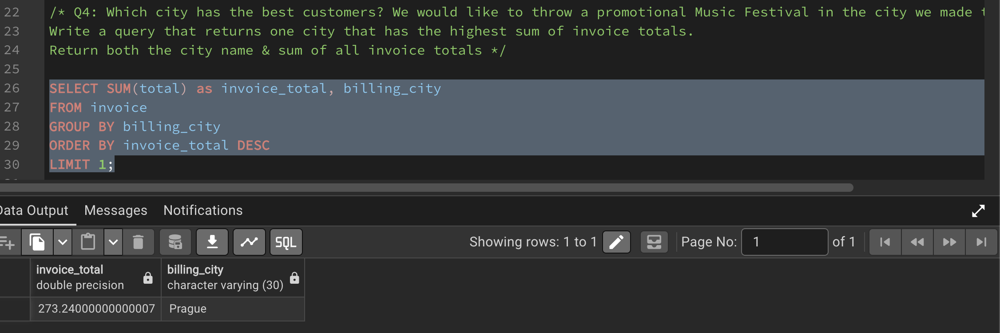
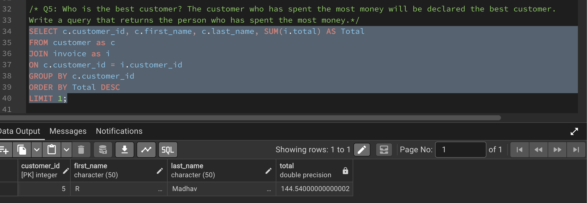
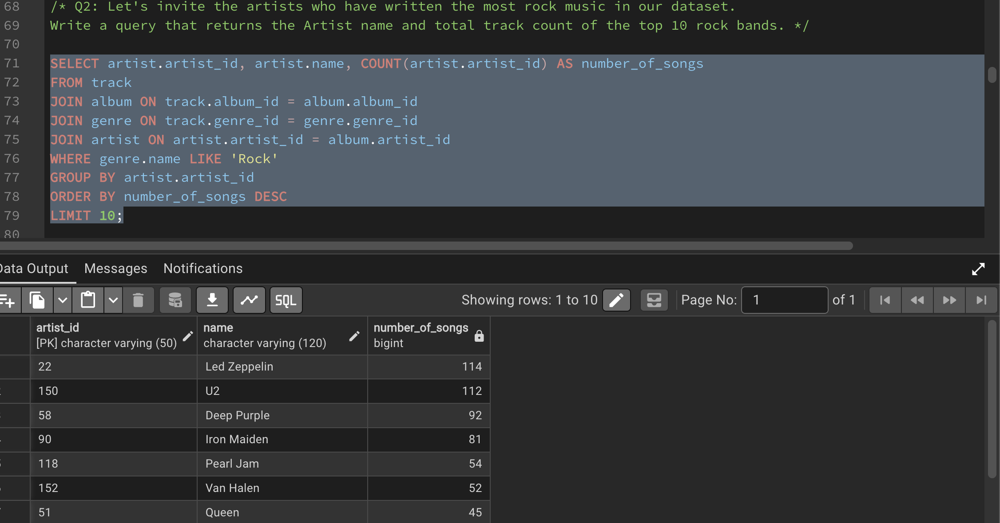
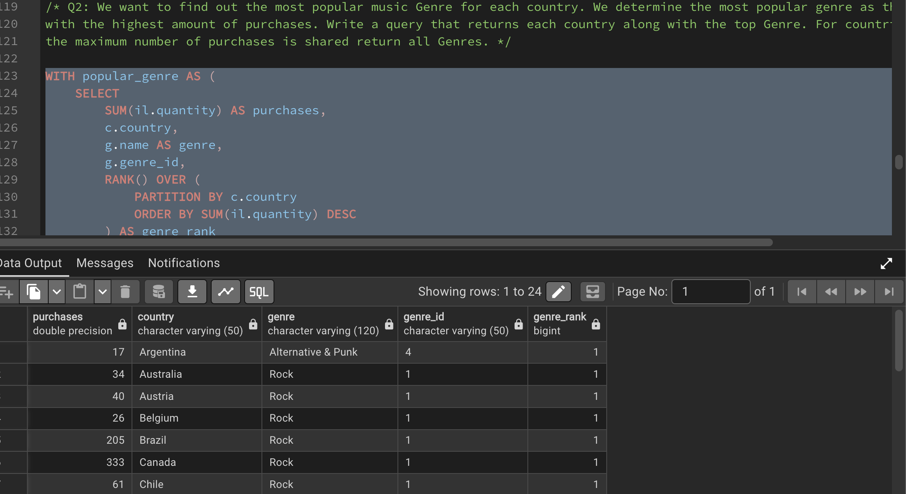

# Music Store SQL Analysis

A SQL portfolio project analysing a digital music store database using PostgreSQL. This project explores customer spending, invoice trends, music genres, and artist catalogues through business-focused SQL queries.

## Project Overview

The objective of this project is to use SQL to answer practical business questions about customer purchasing behaviour, invoice distribution, and music preferences across countries.

The analysis progresses from basic SQL queries to more advanced techniques involving joins, subqueries, Common Table Expressions (CTEs), and window functions.

## Business Questions

### 1. Basic SQL Analysis
- Which employee is the most senior?
- Which countries have the most invoices?
- What are the three highest invoice totals?
- Which billing city has the highest total invoice value?
- Who is the highest-spending customer?

### 2. Joins and Subqueries
- Which customers have purchased Rock music?
- Which artists have the most Rock tracks in the database?
- Which tracks are longer than the average track duration?

### 3. Advanced SQL Analysis
- How much does each customer spend on each artist?
- Which music genre has the highest purchase quantity in each country?
- Who is the highest-spending customer in each billing country?

## Tools and Technologies

- **Database:** PostgreSQL
- **SQL environment:** pgAdmin
- **Version control:** Git and GitHub

## SQL Skills Demonstrated

- Filtering and sorting: `WHERE`, `ORDER BY`, `LIMIT`
- Aggregations: `SUM()`, `COUNT()`, `AVG()`
- Grouping: `GROUP BY`, `DISTINCT`
- Relational data analysis using `INNER JOIN` and multiple-table joins
- Subqueries
- Common Table Expressions (CTEs)
- Window functions: `RANK()` and `PARTITION BY`
- Customer spending and purchase quantity analysis

## Key Findings

### 1. Invoice Distribution by Country

**Finding:** The USA recorded the highest number of invoices (131), followed by Canada (76) and Brazil (61).

**SQL techniques:** `COUNT()`, `GROUP BY`, `ORDER BY`



**Business interpretation:** Invoice counts help identify markets with high transaction volumes. Revenue and average invoice value should also be analysed before deciding which markets are commercially most important.

### 2. Billing City with the Highest Invoice Value

**Finding:** Prague recorded the highest total invoice value, approximately 273.24 in the dataset's currency units.

**SQL techniques:** `SUM()`, `GROUP BY`, `ORDER BY`, `LIMIT`



**Business interpretation:** This identifies a billing city with a high cumulative invoice value. Further analysis of customer demand, costs, and location suitability would be needed before using this result to make an event or marketing decision.

### 3. Highest-Spending Customer

**Finding:** Customer ID 5, displayed as R Madhav, recorded the highest total invoice spending, approximately 144.54 in the dataset's currency units.

**SQL techniques:** `JOIN`, `SUM()`, `GROUP BY`, `ORDER BY`



**Business interpretation:** Understanding the purchasing patterns of high-spending customers could help identify opportunities for customer engagement and targeted promotions.

### 4. Artists with the Largest Rock Track Catalogues

**Finding:** Led Zeppelin ranked first with 114 Rock tracks, followed by U2 with 112 and Deep Purple with 92.

**SQL techniques:** Multiple-table `JOIN`s, `WHERE`, `COUNT()`, `GROUP BY`, `ORDER BY`



**Business interpretation:** Track counts help compare the size of artists' Rock catalogues. They should not be interpreted as direct measures of sales, listening activity, or customer popularity.


### 5. Most Popular Genre by Country

**Finding:** The country-level analysis ranks genres according to the total quantity of tracks purchased. In the reviewed results, Rock ranks first in several countries, while Alternative & Punk ranks first in Argentina with 17 purchases. Canada records 333 Rock purchases and Brazil records 205.

**SQL techniques:** CTEs, aggregate functions, `RANK()`, `PARTITION BY`



**Business interpretation:** Comparing purchase quantities by genre and country can help identify regional differences in music purchasing behaviour and inform further marketing analysis.


*Note: Validate the complete query output before drawing conclusions about the most popular genre across all countries.*

## Project Structure

```text
Music-Store-SQL-Analysis/
│
├── screenshots/
│   ├── customer_artist_spending.png
│   ├── genre_by_country.png
│   ├── highest_revenue_city.png
│   ├── invoice_counts_by_country.png
│   ├── rock_listeners.png
│   ├── top_3_invoice_totals.png
│   ├── top_customer_by_country.png
│   ├── top_rock_artists.png
│   └── top_spending_customer.png
│
├── 01_basic_analysis.sql
├── 02_joins_and_subqueries.sql
├── 03_advanced_analysis.sql
├── Music_Store_database.sql
└── README.md
```

## How to Run the Project

1. Install PostgreSQL and open pgAdmin.
2. Create or restore the music store database using the provided SQL file and the appropriate method for its format.
3. Open the relevant analysis script in pgAdmin.
4. Execute the queries against the database.
5. Review the query outputs and compare them with the findings documented in this README.

## Learning Outcomes

This project strengthened my understanding of relational databases and SQL-based analysis. It provided practical experience in joining related tables, aggregating data, writing subqueries, structuring complex queries with CTEs, and applying window functions to country-level comparisons.

## Repository

Source code and SQL queries are available in this GitHub repository.
